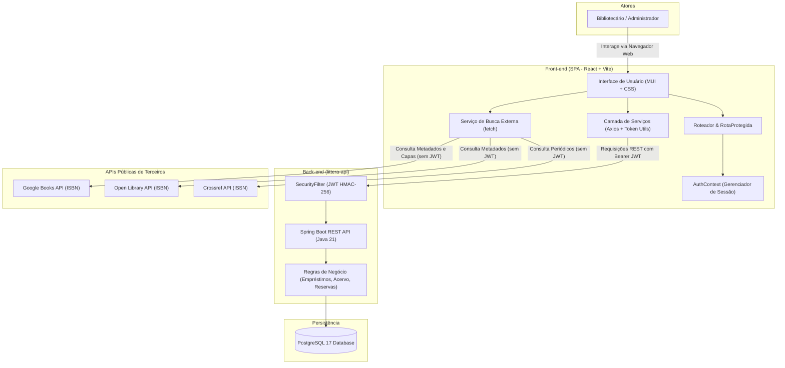
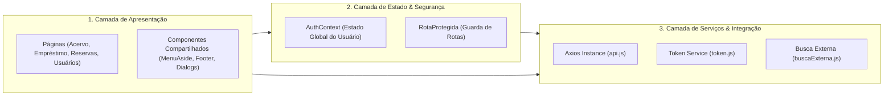
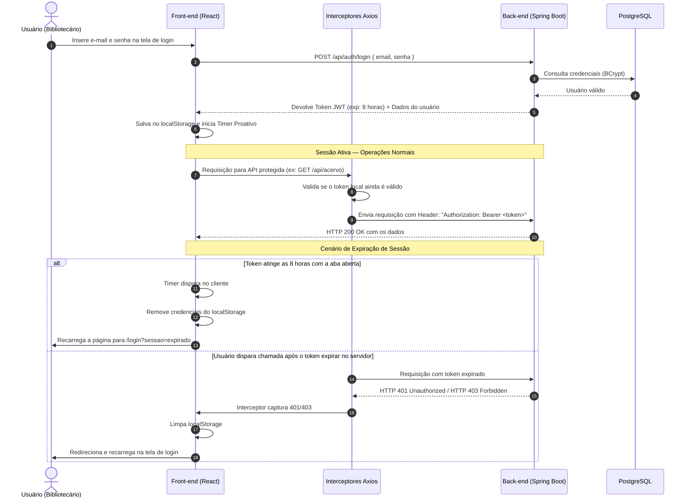

# 📚 Littera — Sistema de Gestão de Biblioteca

<div align="center">


<p align="center">
  <strong>Plataforma moderna, segura e escalável para administração de acervos, leitores, empréstimos e reservas bibliográficas.</strong>
</p>

</div>

---

## 📑 Sumário

- [Visão Geral](#-visão-geral)
- [Arquitetura do Projeto](#-arquitetura-do-projeto)
  - [Visão Macro (C4 Model - Contexto & Containers)](#1-visão-macro-c4-model---contexto--containers)
  - [Arquitetura do Front-end (Camadas e Padrões)](#2-arquitetura-do-front-end-camadas-e-padrões)
  - [Estrutura de Diretórios](#3-estrutura-de-diretórios)
  - [Fluxo de Autenticação e Ciclo de Vida do JWT](#4-fluxo-de-autenticação-e-ciclo-de-vida-do-jwt)
- [Principais Funcionalidades](#-principais-funcionalidades)
- [Regras de Negócio Centrais](#-regras-de-negócio-centrais)
- [Integrações Externas](#-integrações-externas)
- [Stack Tecnológica](#-stack-tecnológica)
- [Configuração e Instalação](#-configuração-e-instalação)
  - [Pré-requisitos](#pré-requisitos)
  - [Variáveis de Ambiente](#variáveis-de-ambiente)
  - [Execução com Docker Compose](#execução-com-docker-compose-recomendado)
  - [Execução Local](#execução-local-manual)
- [Scripts Disponíveis](#-scripts-disponíveis)
- [Documentação do Projeto](#-documentação-do-projeto)
- [Autoria](#-autoria)

---

## 🌟 Visão Geral

O **Littera** é uma solução *full-stack* projetada para otimizar e automatizar a rotina operacional de bibliotecas. A plataforma substitui processos manuais por fluxos inteligentes de controle de inventário, cadastro automático de obras via código de barras ou serviços de metadados, controle rigoroso de devoluções com cálculo de penalidades e monitoramento em tempo real de empréstimos e reservas.

A interface do usuário foi desenhada com foco em **produtividade, acessibilidade e responsividade**, permitindo que bibliotecários realizem operações com poucos cliques em qualquer dispositivo.

---

## 🏗️ Arquitetura do Projeto

O ecossistema **Littera** adota uma **Arquitetura Desacoplada Cliente-Servidor (Client-Server / Decoupled SPA & REST API)**, com autenticação *stateless* e comunicação exclusivamente via JSON.

### 1. Visão Macro (C4 Model - Contexto & Containers)



---

### 2. Arquitetura do Front-end (Camadas e Padrões)

O front-end foi estruturado seguindo o padrão de **Separação de Responsabilidades (SoC)** em camadas bem definidas:



1. **Camada de Apresentação (Pages & Components):**
   - **Páginas (`pages/`):** Controlam a renderização das tabelas de dados, formulários de busca, estados de carregamento e exibição de alertas.
   - **Componentes (`components/`):** Elementos visuais reutilizáveis, modais dinâmicos (`DialogAcervo`, `DialogEmprestimos`, `DialogReservas`, `DialogUsuarios`) e navegação lateral (`MenuAside`).
   - **Visualizadores Ricos:** Integração de balões flutuantes interativos (`Tooltip` com suporte a rolagem) e diálogos modais para leitura de sinopses completas sem quebra de leiaute tabular.

2. **Camada de Roteamento & Guarda de Rotas (`components/RotaProtegida.jsx`):**
   - Implementa o padrão *Route Guard* do React Router v6.
   - Analisa proativamente o estado de autenticação e a validade temporal do JWT antes de liberar o acesso às rotas filhas (`/admin/*`).
   - Se o token for inexistente ou estiver expirado, expurga a sessão e redireciona de imediato para `/login`.

3. **Camada de Estado Global (`src/context/AuthContext.jsx`):**
   - Gerencia o ciclo de vida do usuário autenticado via React Context API.
   - Inicialização segura validando a integridade e expiração do token armazenado no `localStorage`.
   - **Monitoramento Proativo:** Agenda um temporizador (`setTimeout`) baseado na data exata de expiração (`exp`) do token para efetuar logout e recarregamento automático no cliente.
   - **Sincronização de Visibilidade:** Detecta eventos `focus` e `visibilitychange` para identificar expirações ocorridas enquanto a aba esteve em segundo plano ou em suspensão do sistema operacional.

4. **Camada de Serviços e Comunicação HTTP (`services/`):**
   - **`api.js`:** Instância centralizada do Axios configurada com:
     - **Request Interceptor:** Anexa o cabeçalho `Authorization: Bearer <token>` e intercepta chamadas antecipadas caso o token já esteja vencido.
     - **Response Interceptor:** Captura respostas `HTTP 401 (Unauthorized)` ou `HTTP 403 (Forbidden)` emitidas pelo Spring Boot, disparando limpeza automática de credenciais e recarga limpa para a tela de login.
   - **`token.js`:** Módulo utilitário puro com funções para decodificação de claims JWT, cálculo de milissegundos restantes e encerramento padronizado de sessão.
   - **`buscaExterna.js`:** Camada isolada que consome serviços públicos de terceiros utilizando a API nativa `fetch` (sem injetar tokens da biblioteca em servidores externos).

---

### 3. Estrutura de Diretórios

```text
littera/
├── assets/                     # Identidade visual, logotipos e planos de fundo
├── components/                 # Componentes reutilizáveis da interface
│   ├── DialogAcervo/           # Modal dinâmico (Livro/Revista) com leitor de código de barras
│   ├── DialogEmprestimos/      # Modal de emissão e edição de empréstimos
│   ├── DialogReservas/         # Modal de controle de reservas
│   ├── DialogUsuarios/         # Modal de cadastro e edição de leitores
│   ├── Footer/                 # Rodapé padrão da aplicação
│   ├── Login/                  # Formulário de autenticação e tratamento de sessão
│   ├── MenuAside/              # Navegação lateral expansível (dashboard admin)
│   └── RotaProtegida.jsx       # Guarda de rota com validação de token em tempo real
├── documentation/              # Diagramas UML, C4, ER e Diário de Bordo
├── pages/                      # Visões principais da aplicação
│   ├── GerenciamentoAcervo/    # Listagem, sinopse, filtros e gestão de Livros e Revistas
│   ├── GerenciamentoEmprestimo/# Controle de empréstimos ativos, prazos e devoluções
│   ├── GerenciamentoReservas/  # Gestão de filas de reservas e status
│   └── GerenciamentoUsuarios/  # Controle de leitores e monitoramento de bloqueios
├── services/                   # Camada de comunicação assíncrona e utilitários
│   ├── api.js                  # Instância Axios com interceptores bidirecionais
│   ├── apiBuscaAcervo.js       # Utilitários de busca por ISBN / ISSN
│   ├── buscaExterna.js         # Integração direta com Google Books, Open Library e Crossref
│   └── token.js                # Decodificação e ciclo de vida de tokens JWT
├── src/                        # Entrada da aplicação e provedores
│   ├── context/
│   │   └── AuthContext.jsx     # Contexto global de autenticação e timer de expiração
│   ├── App.jsx                 # Mapeamento declarativo de rotas
│   └── main.jsx                # Ponto de inicialização do React no DOM
├── package.json                # Dependências e scripts do projeto
├── vite.config.js              # Configurações do bundler Vite
└── README.md                   # Documentação oficial do projeto
```

---

### 4. Fluxo de Autenticação e Ciclo de Vida do JWT



---

## 🎯 Principais Funcionalidades

### 📚 Gestão Completa de Acervo
- **Suporte Multitipo:** Tratamento especializado para **Livros** (autor, gênero, ISBN, sinopse) e **Revistas** (edição, mês/ano de publicação, ISSN, descrição).
- **Leitor de Código de Barras por Câmera:** Utiliza a câmera do dispositivo via biblioteca `@zxing/browser` para escanear códigos de barras físicos diretamente no navegador, convertendo automaticamente EAN-13 para ISBN/ISSN.
- **Preenchimento Automático Inteligente:** Busca metadados automaticamente nas bases mundiais do Google Books, Open Library e Crossref ao informar o ISBN/ISSN.
- **Tradução Automática de Sinopses:** Suporte a tradução de sinopses estrangeiras para português através de endpoint seguro da API.
- **Visualização Otimizada de Sinopses:** Prévia flutuante interativa ao passar o ponteiro do mouse (`hover`) e diálogo modal detalhado com visualização completa ao clicar.

### 🔄 Controle de Empréstimos e Devoluções
- **Cálculo Dinâmico de Prazos:** Prazos parametrizados conforme o tipo da obra:
  - 📖 **Livros:** 14 dias de prazo previsto.
  - 📰 **Revistas:** 7 dias de prazo previsto.
- **Sincronização de Estoque:** Atualização automática do estoque disponível e quantidade emprestada no momento da concessão e devolução.
- **Controle de Devolução Real:** Registro exato da data de retorno com identificação automática de pendências.

### ⏳ Gestão de Reservas
- Mapeamento e fila de espera para itens com estoque esgotado.
- Controle de status de reservas e vinculação com usuários ativos.

### 👥 Gestão de Usuários e Leitores
- Cadastro completo de leitores com máscara de telefone e validação de e-mail.
- Histórico de empréstimos e status de aptidão do usuário.

---

## ⚖️ Regras de Negócio Centrais

1. **Política de Penalidades por Atraso:**
   - O sistema calcula os dias de atraso entre a data de devolução prevista e a devolução real.
   - Aplica-se a regra de **bloqueio temporário equivalente ao dobro dos dias de atraso**:
   $$\text{Dias de Bloqueio} = 2 \times (\text{Data Devolução Real} - \text{Data Devolução Prevista})$$
   - Enquanto bloqueado, o leitor fica impedido de realizar novos empréstimos ou reservas.
2. **Segurança de Sessão e Token:**
   - O token JWT emitido pelo backend possui validade estrita de **8 horas**.
   - O front-end monitora ativamente esse ciclo e impede requisições zumbis, redirecionando o usuário para nova autenticação assim que o período expira.
3. **Imutabilidade de Tipo:**
   - Uma obra cadastrada como Livro não pode ter seu tipo convertido para Revista (e vice-versa), garantindo integridade referencial nas regras de empréstimo.

---

## 🌐 Integrações Externas

O front-end conecta-se a bases públicas de dados bibliográficos com isolamento total de credenciais:

| Serviço | Finalidade | Identificador | Mecanismo de Busca |
| :--- | :--- | :--- | :--- |
| **Google Books API** | Título, autor, ano, gênero, idioma, capa e sinopse em PT-BR | ISBN-10 / ISBN-13 | `fetch` nativo com fallback |
| **Open Library API** | Metadados complementares, edições e capas em alta resolução | ISBN | `fetch` nativo com fallback |
| **Crossref API** | Título oficial e publicadora de periódicos científicos | ISSN | `fetch` nativo formatado (`XXXX-XXXX`) |

---

## 💻 Stack Tecnológica

### Front-end (`littera`)
* **Linguagem & Plataforma:** JavaScript (ESNext), HTML5, CSS3
* **Biblioteca Principal:** [React 18.3](https://react.dev/)
* **Ferramenta de Build / Bundler:** [Vite 8.x](https://vite.dev/)
* **Roteamento:** [React Router DOM 6.x](https://reactrouter.com/)
* **Componentes & UI:** [Material UI (MUI 9.x)](https://mui.com/)
* **Ícones:** [MUI Icons](https://mui.com/material-ui/material-icons/), [React Icons](https://react-icons.github.io/react-icons/)
* **Cliente HTTP:** [Axios 1.20](https://axios-http.com/)
* **Leitura de Código de Barras:** [@zxing/browser](https://github.com/zxing-js/browser) e [@zxing/library](https://github.com/zxing-js/library)
* **Manipulação de Datas:** [Day.js](https://day.js.org/) e [React Datepicker](https://reactdatepicker.com/)

### Back-end (`littera-api`)
* **Linguagem:** Java 21 LTS
* **Framework:** Spring Boot 4.x (Spring Web, Spring Security, Spring Data JPA, Actuator)
* **Segurança:** Auth0 Java JWT (HMAC-256), BCrypt Password Encoder
* **Banco de Dados:** PostgreSQL 17
* **Controle de Migrações:** Flyway Migration
* **Gerenciador de Dependências:** Gradle
* **Testes:** JUnit 5, Mockito, AssertJ

---

## 🚀 Configuração e Instalação

### Pré-requisitos
* [Node.js](https://nodejs.org/) versão 18 ou superior.
* Gerenciador de pacotes `npm` ou `yarn`.
* [Docker](https://www.docker.com/) e [Docker Compose](https://docs.docker.com/compose/) (caso opte pela execução em contêineres).
* Back-end [littera-api](https://github.com/lucas-brum545/littera-api) em execução (ou container ativo).

---

### Variáveis de Ambiente

Crie um arquivo `.env` na raiz do diretório `littera/` com base no exemplo abaixo:

```env
# URL base da API do Littera (Spring Boot)
VITE_API_URL=http://localhost:8080

# (Opcional) Chave de API do Google Books para ampliar cotas de consulta
VITE_GOOGLE_BOOKS_KEY=
```

---

### Execução com Docker Compose (Recomendado)

Caso você possua o repositório completo com o `docker-compose.yml`:

```bash
# Clone ambos os projetos lado a lado
git clone https://github.com/lucas-brum545/littera.git
git clone https://github.com/lucas-brum545/littera-api.git

# Suba todos os serviços (Banco + API + Front-end)
docker-compose up --build -d
```

Acesse a aplicação:
* **Front-end:** [http://localhost:5173](http://localhost:5173)
* **Back-end API:** [http://localhost:8080](http://localhost:8080)
* **Swagger UI:** [http://localhost:8080/swagger-ui/index.html](http://localhost:8080/swagger-ui/index.html)
* **Health Check:** [http://localhost:8080/actuator/health](http://localhost:8080/actuator/health)

---

### Execução Local (Manual)

#### 1. Iniciar o Front-end

```bash
# 1. Acesse o diretório do front-end
cd littera

# 2. Instale as dependências
npm install

# 3. Inicie o servidor local de desenvolvimento
npm run dev
```

O terminal exibirá o endereço de acesso local (por padrão `http://localhost:5173`).

---

## 📜 Scripts Disponíveis

No diretório do front-end, você pode executar:

| Comando | Descrição |
| :--- | :--- |
| `npm run dev` | Inicia o servidor de desenvolvimento com Hot Module Replacement (HMR). |
| `npm run build` | Compila os arquivos para produção com otimização e minificação na pasta `dist/`. |
| `npm run preview` | Executa localmente o build de produção para testes pré-deploy. |
| `npm run lint` | Executa o ESLint para identificar inconsistências no código. |

---

## 📂 Documentação do Projeto

Arquivos de especificação arquitetural, modelagem de dados e diagramas estão disponíveis na pasta [`documentation/`](file:///c:/Users/User/Desktop/littera/documentation):

* **Diagramas C4 Model:** Nível 1 (Contexto) e Nível 2 (Contêineres).
* **Diagrama Entidade-Relacionamento (ER):** Modelagem lógica e física do banco PostgreSQL.
* **Diagramas de Sequência UML:**
  * Fluxo de Login e Autenticação JWT.
  * Fluxo de Concessão e Devolução de Empréstimos.
  * Fluxo de Criação e Ativação de Reservas.
  * Fluxo de Gerenciamento e Bloqueio de Usuários.
* **Diário de Bordo Ágil:** Histórico de iterações, planejamento de sprints e decisões de arquitetura.

---

## 👥 Autoria

Projeto idealizado e desenvolvido pela equipe:

* **Lucas Brum**
* **Luiz Lobato**
* **Joyce Cruz**
* **Milton Martins**
* **Karoline Oliveira**
* **Enzo Ornellas**

---

<div align="center">
  <p>Littera — Simplificando a gestão do conhecimento. 📖✨</p>
</div>
